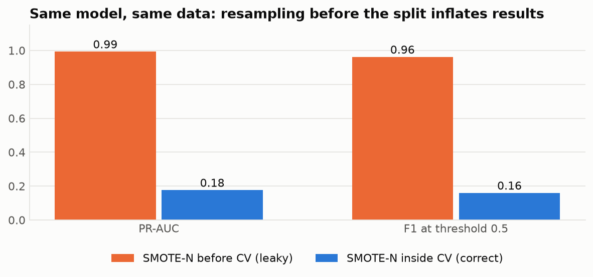
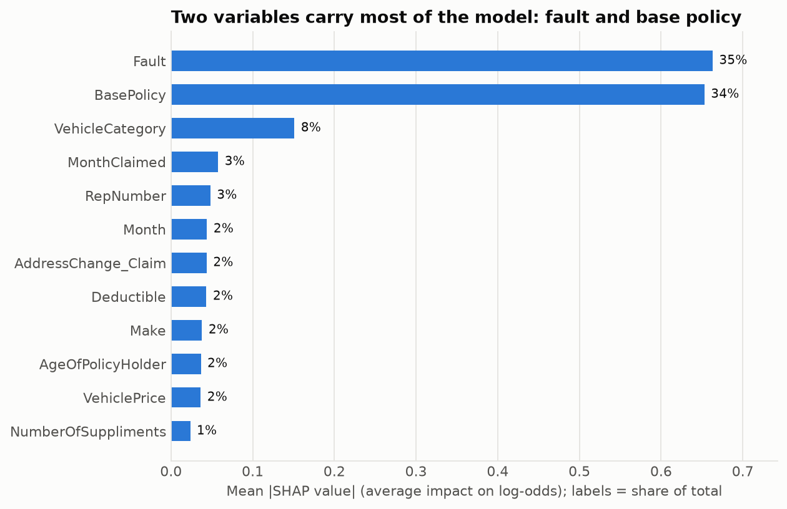
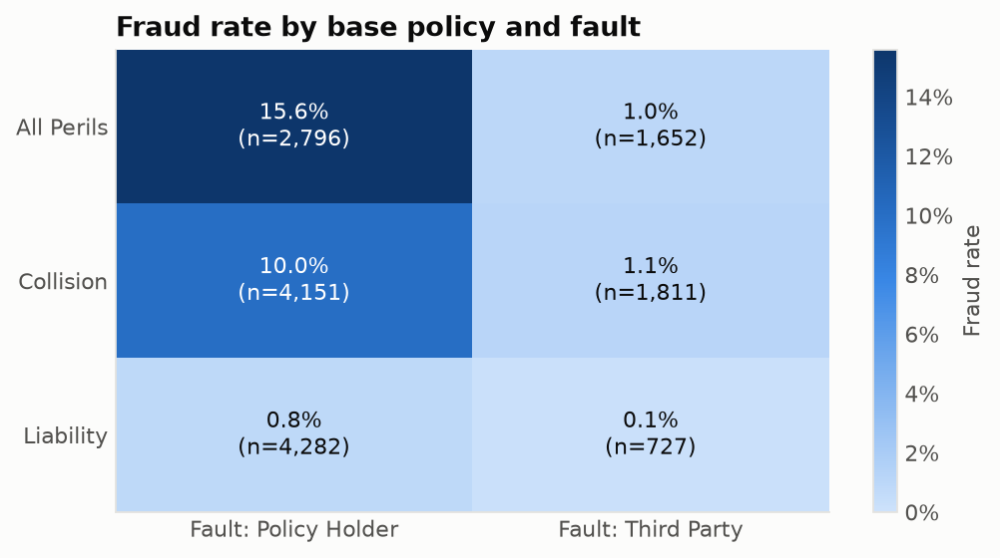
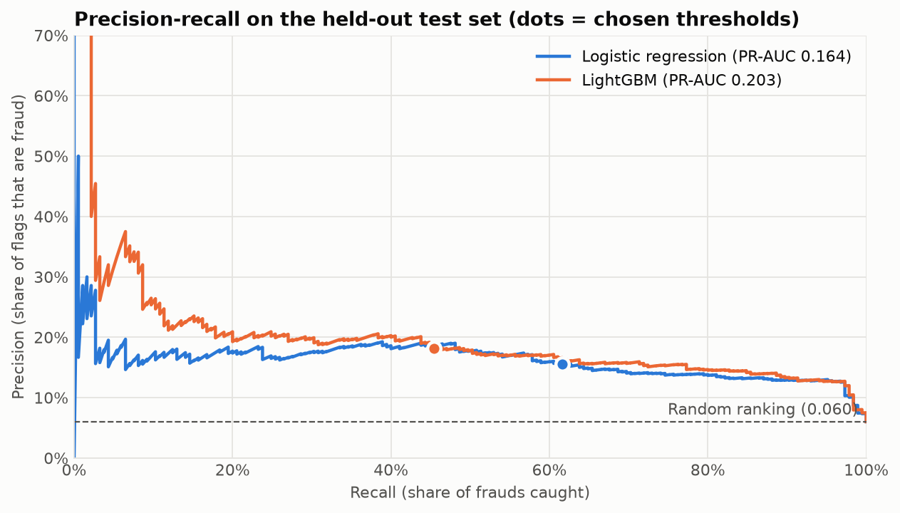
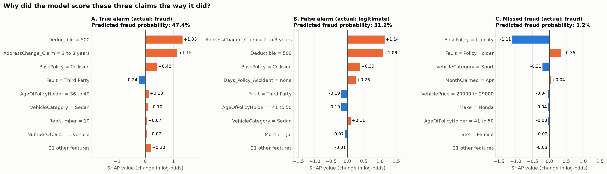
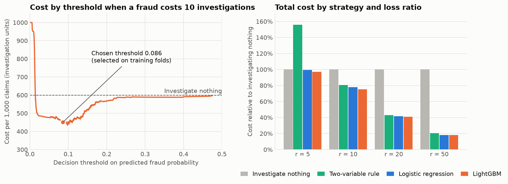

🇬🇧 [English version](README_EN.md)

# Sigorta Hasar Taleplerinde Sahtekârlık Tespiti ve Açıklanabilir Yapay Zekâ

15.420 araç sigortası hasar talebi üzerinde, sahtekârlık riskini puanlayan ve **kararını
açıklayabilen** bir model. Proje; istatistiksel analiz, sızıntısız doğrulama, SHAP ile
açıklanabilirlik ve maliyete dayalı eşik seçimini uçtan uca kapsar.

**Yazar:** İrem Esma Üner · Hacettepe Üniversitesi, İstatistik

| | |
|---|---|
| **Problem** | Taleplerin yalnızca %6'sı sahte. Hangi talepler incelemeye gitmeli? |
| **Veri** | 15.420 talep, 33 değişken, 1994–1996 ([ayrıntı](data/README.md)) |
| **Modeller** | Lojistik regresyon (yorumlanabilir temel model) ve LightGBM |
| **Metrikler** | PR-AUC, precision, recall, F1 (accuracy değil) |
| **Sonuç** | LightGBM test PR-AUC **0,203** (%95 GA 0,164–0,254); rastgele sıralamanın 3,4 katı |

## Öne çıkan üç bulgu

### 1. Yanlış doğrulama düzeni sonuçları mükemmel gösterir

Bu veri setiyle yapılmış birçok açık çalışma %90'ın üzerinde skor raporluyor. Aynı model,
SMOTE veri bölünmeden **önce** uygulandığında PR-AUC 0,99 görünüyor; doğru kurulumda
(yeniden örnekleme yalnızca eğitim katlarında) 0,18. Bu projedeki sayılar mütevazı ama
gerçek.



### 2. Yeniden örnekleme sıralama kalitesini artırmadı

Dört strateji (hiçbiri, sınıf ağırlığı, alt örnekleme, SMOTE-N) iki modelde
karşılaştırıldı. En yüksek PR-AUC, veri **değiştirilmediğinde** elde edildi. Stratejilerin
asıl etkisi çalışma noktasını kaydırmak; aynı sonuca eşik seçimiyle ulaşılıyor ve
olasılıklar kalibre kalıyor.

| Model | Strateji | CV PR-AUC | Recall @ 0,5 | En iyi F1 (eşik ayarlı) |
|---|---|---|---|---|
| LightGBM | **hiçbiri** | **0,200** | %4 | **0,251** |
| LightGBM | sınıf ağırlığı | 0,188 | %50 | 0,244 |
| LightGBM | alt örnekleme | 0,153 | %81 | 0,242 |
| LightGBM | SMOTE-N | 0,164 | %22 | 0,230 |

### 3. Model iki değişkene dayanıyor; değeri sıralamada

SHAP'e göre **kusur** ve **poliçe türü** toplam etkinin %69'unu taşıyor. Yalnızca bu iki
değişkene dayanan basit bir kural bile tasarrufun çoğunu sağlıyor; LightGBM bunun üzerine
%4–12 ek tasarruf getiriyor. Modelin asıl katkısı inceleme kuyruğunun en başında:
en yüksek skorlu %1'lik dilimde precision %35 (rastgele incelemenin 6 katı).



## Veri ve keşifsel analiz

- Resmî eksik değer yok, ama gizli sorunlar var: `Age = 0` olan 320 kayıt, satır numarası
  olan `PolicyNumber`, başka iki değişkenden türetilmiş `PolicyType`.
- 31 değişken ki-kare testiyle tarandı; p-değerleri Benjamini–Hochberg ile düzeltildi,
  sıralama Cramér's V (etki büyüklüğü) ile yapıldı.
- **Karıştırıcı etki:** Geçmiş hasar sayısı arttıkça sahtekârlık oranı düşüyor gibi
  görünüyor; poliçe türü sabit tutulduğunda bu ilişki kayboluyor.



## Model sonuçları (test seti, 3.084 talep, 185 sahtekârlık)

| Model | PR-AUC (%95 GA) | ROC-AUC | Precision | Recall | F1 |
|---|---|---|---|---|---|
| Rastgele sıralama | 0,060 | 0,500 | | | |
| İki değişkenli kural | 0,140 | | %12,6 | %94,6 | 0,222 |
| Lojistik regresyon | 0,164 (0,136–0,204) | 0,810 | %15,5 | %61,6 | 0,248 |
| **LightGBM** | **0,203** (0,164–0,254) | 0,822 | %18,1 | %45,4 | 0,259 |

Eşikler eğitim setindeki kat dışı tahminlerle seçildi; test seti yalnızca bir kez
kullanıldı. LightGBM ile lojistik regresyon arasındaki PR-AUC farkı +0,039
(eşleştirilmiş bootstrap %95 GA: +0,005 ile +0,076).



**Zaman dışı doğrulama:** 1994–95 ile eğitilip 1996'da test edildiğinde LightGBM'in
rastgele sıralamaya üstünlüğü 3,4 kattan 2,6 kata düşüyor (PR-AUC 0,137). Rastgele ayrım
canlıdaki performansı olduğundan iyi gösteriyor; izleme ve yeniden eğitim gerekli.

## Açıklanabilirlik: model bu talebi neden şüpheli buldu?

Üç talep kuralla seçildi (en yüksek skorlu sahte, en yüksek skorlu meşru, en düşük skorlu
sahte). Turuncu çubuklar riski artıran, mavi çubuklar azaltan etkenlerdir.



A ve B neredeyse aynı profile sahip, ama biri sahte, diğeri meşru: **skor bir hüküm değil,
öncelik sinyalidir.** C'yi benzer binlerce meşru talepten ayıran bir bilgi veride yok.

SHAP sonuçları ayrıca sorgulandı: permütasyon önemi, SHAP'te üst sıralarda görünen bazı
değişkenlerin (`RepNumber`, takvim değişkenleri) test verisinde gerçek katkı sağlamadığını
gösterdi.

## İş yorumu: maliyet ve eşik

Eşik, tek bir parametreye bağlandı: **r = ortalama sahte tazminat / bir inceleme maliyeti**.
Kalibre bir modelde en iyi eşik `1 / r`'dir; veriden seçilen eşikler bu değerle uyuşuyor.



Önerilen üç kademeli iş akışı (test seti):

| Kademe | Taleplerin payı | Sahtekârlık oranı | İşlem |
|---|---|---|---|
| 1. Düşük risk | %54 | %0,3 | Hızlı ödeme, rastgele örneklem denetimi |
| 2. Orta risk | %45 | %12 | Skor sırasına göre standart inceleme |
| 3. Yüksek risk | %1,2 | %34 | Özel inceleme birimi |

## Sınırlılıklar

- Veri 1994–1996'ya ait ve asıl yayıncısı doğrulanamıyor; güncel bir portföyü temsil etmez.
- Etiket "tespit edilen" sahtekârlıktır; yakalanmamış vakalar meşru görünür.
- Hasar tutarı yok; maliyet analizi varsayımsal birimlerle yapıldı.
- Test setinde 185 sahtekârlık var; güven aralıkları geniş.

## Nasıl çalıştırılır

```bash
git clone https://github.com/iremesmauner/insurance-fraud-detection.git
cd insurance-fraud-detection
python -m venv .venv && source .venv/bin/activate   # Windows: .venv\Scripts\activate
pip install -r requirements.txt
jupyter nbconvert --to notebook --execute --inplace notebooks/0*.ipynb
```

Defterler sırayla çalıştırılmalıdır (03 ve 04, 02'nin kaydettiği modeli kullanır).
Toplam süre 2 çekirdekli bir makinede yaklaşık 5 dakikadır. Python 3.13 ile test edildi.

## Repo yapısı

```
├── data/raw/                  Ham veri (değiştirilmemiş) ve kaynak bilgisi
├── notebooks/
│   ├── 01_eda_and_statistical_tests.ipynb
│   ├── 02_modeling.ipynb
│   ├── 03_explainability_shap.ipynb
│   └── 04_business_threshold.ipynb
├── src/                       Tekrar kullanılabilir fonksiyonlar
├── reports/figures/           Grafikler
├── reports/metrics/           Defterlerin ürettiği sayılar (JSON/CSV)
└── requirements.txt
```
