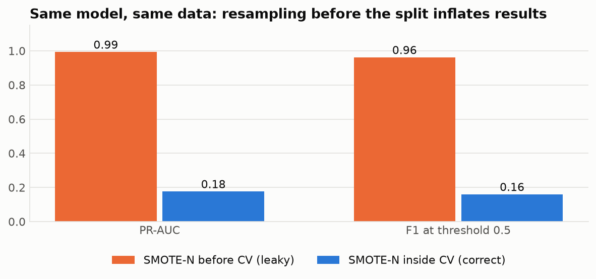
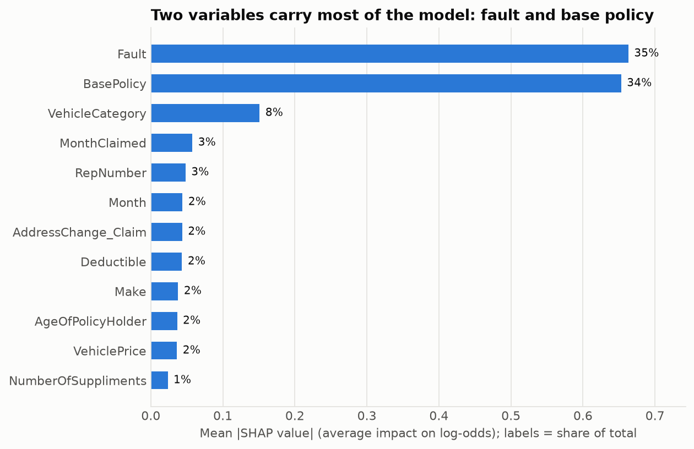
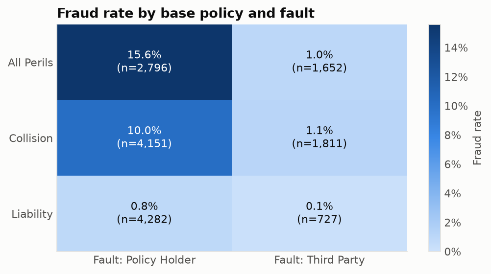
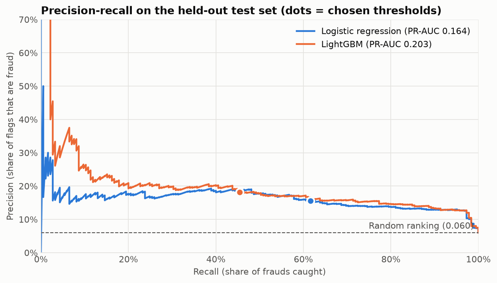
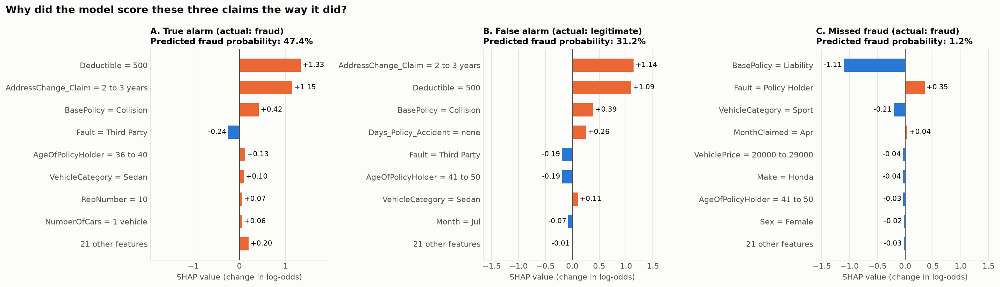
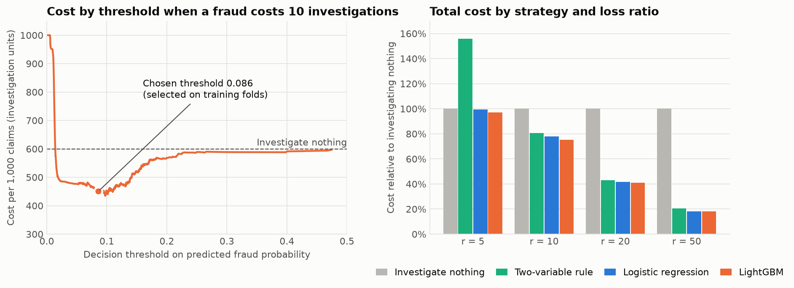

🇹🇷 [Türkçe sürüm](README.md)

# Insurance Claim Fraud Detection with Explainable AI

A model that scores fraud risk on 15,420 vehicle insurance claims and **explains its
decisions**. The project covers statistical analysis, leak-free validation, SHAP
explanations and cost-based threshold selection end to end.

**Author:** İrem Esma Üner · Hacettepe University, Statistics

| | |
|---|---|
| **Problem** | Only 6% of claims are fraudulent. Which claims should be investigated? |
| **Data** | 15,420 claims, 33 variables, 1994–1996 ([details](data/README.md)) |
| **Models** | Logistic regression (interpretable baseline) and LightGBM |
| **Metrics** | PR-AUC, precision, recall, F1 (not accuracy) |
| **Result** | LightGBM test PR-AUC **0.203** (95% CI 0.164–0.254), 3.4 times a random ranking |

## Three key findings

### 1. A flawed validation setup makes results look perfect

Many public analyses of this dataset report scores above 90%. The same model shows a
PR-AUC of 0.99 when SMOTE is applied **before** the data is split, and 0.18 in the correct
setup (resampling on training folds only). The numbers in this project are modest but
real.



### 2. Resampling did not improve ranking quality

Four strategies (none, class weights, undersampling, SMOTE-N) were compared for both
models. The highest PR-AUC came from leaving the data **unchanged**. The strategies mainly
shift the operating point; threshold selection achieves the same result and keeps the
probabilities calibrated.

| Model | Strategy | CV PR-AUC | Recall @ 0.5 | Best F1 (tuned threshold) |
|---|---|---|---|---|
| LightGBM | **none** | **0.200** | 4% | **0.251** |
| LightGBM | class weights | 0.188 | 50% | 0.244 |
| LightGBM | undersampling | 0.153 | 81% | 0.242 |
| LightGBM | SMOTE-N | 0.164 | 22% | 0.230 |

### 3. The model relies on two variables; its value is in ranking

According to SHAP, **fault** and **base policy** carry 69% of the total effect. A simple
rule built on these two variables already delivers most of the savings; LightGBM adds a
further 4–12%. The model contributes most at the very top of the review queue: precision
is 35% in the top-scored 1% of claims (6 times a random review).



## Data and exploratory analysis

- No explicit missing values, but hidden issues: 320 records with `Age = 0`, a
  `PolicyNumber` that is a row number, and a `PolicyType` derived from two other variables.
- 31 variables were screened with chi-square tests; p-values were adjusted with
  Benjamini–Hochberg and variables were ranked by Cramér's V (effect size).
- **Confounding:** the fraud rate appears to fall as the number of past claims rises; the
  relationship disappears once the policy type is held constant.



## Model results (test set, 3,084 claims, 185 frauds)

| Model | PR-AUC (95% CI) | ROC-AUC | Precision | Recall | F1 |
|---|---|---|---|---|---|
| Random ranking | 0.060 | 0.500 | | | |
| Two-variable rule | 0.140 | | 12.6% | 94.6% | 0.222 |
| Logistic regression | 0.164 (0.136–0.204) | 0.810 | 15.5% | 61.6% | 0.248 |
| **LightGBM** | **0.203** (0.164–0.254) | 0.822 | 18.1% | 45.4% | 0.259 |

Thresholds were chosen on out-of-fold predictions from the training set; the test set was
used only once. The PR-AUC difference between LightGBM and logistic regression is +0.039
(paired bootstrap 95% CI: +0.005 to +0.076).



**Out-of-time validation:** when trained on 1994–95 and tested on 1996, LightGBM's lift
over a random ranking drops from 3.4 to 2.6 (PR-AUC 0.137). A random split overstates
live performance; monitoring and retraining are required.

## Explainability: why did the model flag this claim?

Three claims were selected by rule (highest-scored fraud, highest-scored legitimate claim,
lowest-scored fraud). Orange bars raise the risk, blue bars lower it.



A and B have almost the same profile, yet one is fraudulent and the other legitimate:
**the score is a priority signal, not a verdict.** Nothing in the data separates C from
thousands of similar legitimate claims.

The SHAP results were also challenged: permutation importance showed that some variables
ranked high by SHAP (`RepNumber`, calendar variables) add nothing on the test data.

## Business view: cost and threshold

The threshold depends on one parameter: **r = average fraudulent payout / cost of one
investigation**. For a calibrated model the optimal threshold is `1 / r`, and the
thresholds selected from the data agree with it.



Proposed three-tier workflow (test set):

| Tier | Share of claims | Fraud rate | Action |
|---|---|---|---|
| 1. Low risk | 54% | 0.3% | Fast-track payment, random sample audit |
| 2. Medium risk | 45% | 12% | Standard review in score order |
| 3. High risk | 1.2% | 34% | Special investigation unit |

## Limitations

- The data covers 1994–1996 and its original publisher cannot be verified; it does not
  represent a current portfolio.
- The label is *detected* fraud; undetected cases appear as legitimate.
- There are no claim amounts, so the cost analysis uses hypothetical units.
- The test set holds 185 frauds, so confidence intervals are wide.

## How to run

```bash
git clone https://github.com/iremesmauner/insurance-fraud-detection.git
cd insurance-fraud-detection
python -m venv .venv && source .venv/bin/activate   # Windows: .venv\Scripts\activate
pip install -r requirements.txt
jupyter nbconvert --to notebook --execute --inplace notebooks/0*.ipynb
```

Run the notebooks in order (03 and 04 use the model saved by 02). Total run time is about
5 minutes on a 2-core machine. Tested with Python 3.13. Notebook narrative is in Turkish;
code comments and figures are in English.

## Repository structure

```
├── data/raw/                  Raw data (unmodified) and source information
├── notebooks/
│   ├── 01_eda_and_statistical_tests.ipynb
│   ├── 02_modeling.ipynb
│   ├── 03_explainability_shap.ipynb
│   └── 04_business_threshold.ipynb
├── src/                       Reusable functions
├── reports/figures/           Figures
├── reports/metrics/           Numbers produced by the notebooks (JSON/CSV)
└── requirements.txt
```
